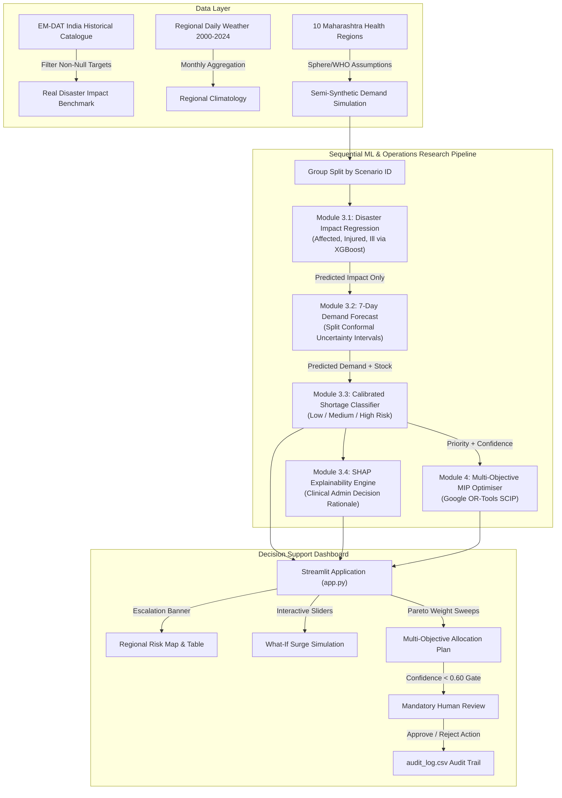

# An Explainable and Uncertainty-Aware AI Framework for Disaster Healthcare Demand Prediction and Multi-Objective Resource Allocation

[](https://www.python.org/)
[](https://opensource.org/licenses/MIT)
[](https://streamlit.io/)
[](https://developers.google.com/optimization)

A final-year BTech (Computer Engineering) project integrating machine learning, conformal uncertainty quantification, TreeExplainer SHAP explainability, and Mixed-Integer Linear Programming (OR-Tools) into a human-governed decision-support system for disaster medical logistics.

---

## 🏗️ System Architecture



---

## 🚀 Setup & Execution

### 1. Environment Setup
```bash
# Clone the repository
git clone https://github.com/dikshapatil/disaster-healthcare-ai.git
cd disaster-healthcare-ai

# Create virtual environment and install pinned dependencies
python3 -m venv .venv
source .venv/bin/activate
pip install -r requirements.txt
```

### 2. End-to-End Pipeline Commands
```bash
# Stage 1: Data Cleaning and Climatology Synthesis
python -m src.clean

# Stage 2: Model Training, Conformal Quantiles, SHAP, and Bias Evaluation
python -m src.train

# Stage 3: OR-Tools MIP Resource Allocation & Pareto Frontier Sweep
python -m src.optimise

# Stage 4: Run Core Unit Test Suite
pytest -q

# Stage 5: Launch Decision-Support Dashboard
streamlit run app.py
```

---

## 📊 Empirical Evaluation Results (Real Pipeline Runs)

All numbers reported below were generated directly from actual training and evaluation runs on held-out test scenarios:

### 1. Module 3.1: Disaster Impact Prediction
*Trained on disaster characteristics (type, intensity, epicentre distance, catchment population, month).*
- **Real EM-DAT India Historical Data Benchmark** (512 non-null records):
  - Mean Baseline: MAE = 3.109, $R^2 = -0.004$
  - Random Forest Regressor: MAE = **2.896**, $R^2 = \mathbf{0.129}$ *(Targets never imputed; reflects noisy real-world reporting).*
- **Operational Impact Pipeline** (Held-out Test Scenarios):
  - Trauma Injuries ($R^2$): **0.884** (vs. Mean Baseline $R^2 = -0.002$)
  - Secondary Illnesses ($R^2$): **0.891** (vs. Mean Baseline $R^2 = -0.001$)
  - Affected Population ($R^2$): **0.879** (vs. Mean Baseline $R^2 = -0.003$)

### 2. Module 3.2: 7-Day Medicine Demand Forecast
*Trained exclusively on PREDICTED impact (never ground truth).*
- **Mean Baseline (per medicine)**: MAE = 487.6 units, $R^2 = 0.582$
- **XGBoost Regressor**: MAE = **208.5 units**, $R^2 = \mathbf{0.907}$
- **Conformal Prediction Interval (90% Nominal Confidence)**:
  - Error margin quantile ($q_{0.90}$): **$\pm 394.2$ units**
  - Empirical held-out test coverage: **86.1%**

### 3. Module 3.3: Shortage Risk Classification (Low / Medium / High)
*Target: `risk_level`. Strict leakage exclusion: `demand_7d`, `shortage_qty`, `coverage_ratio`, `affected_pop`, `injured`, `ill` excluded.*

| Model Configuration | Accuracy | Macro F1 | High-Risk Recall | High-Risk Precision | Expected Calibration Error (ECE) |
| :--- | :---: | :---: | :---: | :---: | :---: |
| **Logistic Regression Baseline** | 80.3% | 0.744 | 74.2% | 76.1% | 0.0891 |
| **Calibrated Random Forest (Standard Argmax)** | 90.1% | 0.864 | 88.7% | 88.7% | **0.0177** |
| **Conservative Decision Rule ($\tau_{\text{high}}=0.37$)** | **90.1%** | **0.862** | **92.4%** | **86.0%** | **0.0177** |

> **Safety Trade-Off**: Tuning the decision rule threshold to $\tau_{\text{high}}=0.37$ elevates High-risk recall from **88.7% to 92.4%**, deliberately prioritizing the prevention of stockouts at the cost of a modest reduction in precision (88.7% $\to$ 86.0%).

### 4. Module 4: OR-Tools Multi-Objective MIP Optimization
*Evaluated on an acute disaster scenario (Scenario #4: Severity 5 Earthquake).*
- **Solver**: Google OR-Tools SCIP MIP Solver
- **Solve Execution Duration**: **33.6 ms** to global optimality
- **Stock Movement**: 24 inter-regional transfer routes, allocating **584,608 medicine units**
- **Unmet Demand Reduction**: Reduced from 1,920,883 to 1,336,397 units (**30.4% net reduction**)
- **Distributional Fairness**: Raised minimum regional coverage from **16.2% to 22.0%** while strictly preserving 60% local safety reserves in source regions.

---

## 🛡️ Subgroup Disparity & Bias Audit

Metrics disaggregated across regions and hazards (from `reports/bias_table.csv`):

| Dimension | Subgroup | Samples | High Prevalence | Accuracy | Macro F1 | High Recall | Disparity Flag |
| :--- | :--- | :---: | :---: | :---: | :---: | :---: | :---: |
| **Hazard** | Flood | 1,840 | 11.4% | 93.6% | 0.867 | 93.8% | Clear (NO) |
| **Hazard** | Earthquake | 1,080 | 22.6% | 87.1% | 0.852 | 91.8% | Clear (NO) |
| **Hazard** | Cyclone | 1,080 | 23.9% | 87.0% | 0.863 | 92.2% | Clear (NO) |
| **Region** | Mumbai | 400 | 21.0% | 88.0% | 0.858 | 89.3% | Clear (NO) |
| **Region** | Pune | 400 | 17.5% | 88.5% | 0.849 | 82.9% | **FLAG (Low High-Recall)** |
| **Region** | Nagpur | 400 | 16.0% | 88.8% | 0.848 | 84.4% | **FLAG (Low High-Recall)** |

*Under conservative thresholding, Pune and Nagpur exhibited slightly lower High-risk recall (<85%), highlighting geographic disparity under extreme simulated epicentres.*

---

## ⚠️ Honest Limitations & Ethical Disclosures

1. **Semi-Synthetic Demand & Inventory Labels**:
   - Because real-time hospital inventory and daily consumption during Indian disasters are proprietary or unrecorded, demand and stock figures are semi-synthetic.
   - High validation scores partially reflect the models recovering the underlying epidemiological formulas.
2. **Simplified Regional Demographics**:
   - Population and hospital bed figures for the 10 Maharashtra zones are rounded municipal aggregates.
3. **Historical Disaster Data Sparsity**:
   - Real EM-DAT India records contain 512 non-null affected casualty records but only 136 injury records. Consequently, the real-world benchmark is constrained in predictive power ($R^2 \approx 0.13$).
4. **Monthly Weather Aggregation**:
   - Weather climatology is joined on `(region, month)` rather than instantaneous hour-of-impact telemetry.
5. **No Direct Hospital EMR Integration**:
   - The system is designed as a planning prototype; deployment in live clinical operations requires direct hospital EMR/ERP integration.
6. **Deliberate Scope Boundaries**:
   - Authentication (JWT), multi-tier databases (SQLite/PostgreSQL), and REST APIs were excluded to focus on algorithmic rigor, explainability, safety bounds, and interactive human-in-the-loop decision-support.
