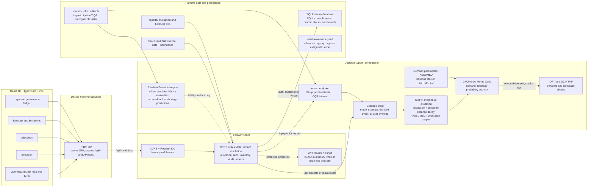

# Disaster Healthcare AI: Impact Prioritization & Resource Allocation

> **A demonstration-oriented decision-support prototype for event-impact prioritization, simulated healthcare demand, and resource allocation. It is not a validated district-level healthcare-demand predictor or production-ready system.**
> *Maharashtra 35 Districts*¹ | React 18 & TypeScript | FastAPI & Python 3.13 | Google OR-Tools SCIP | Conformal Quantile Regression | SHA-256 Audit Ledger | Docker

---

## 1. System Architecture



In local development, Vite serves the frontend on port 5173 and the API is called at port 8000; Nginx is used by the Docker frontend. Docker Compose publishes Nginx on host ports 80 and 5173 and FastAPI on 8000. `app.py` remains a separate Streamlit fallback and is not part of this React/Nginx request path. The surrogate artifact supports reported fidelity metrics; live shortage risks are computed by the Monte-Carlo simulation.

---

## 2. Executive Overview

Disaster healthcare logistics during extreme natural hazards face severe spatial imbalances, sudden demand spikes, and opaque decision-making. This project is a **demonstration-oriented full-stack prototype** for exploring event-impact estimates, simulated medicine demand, and district-to-district resource allocation across Maharashtra. The impact model estimates an event's recorded total affected; it does not directly predict hospital demand. Mapping event totals to districts, demand rates, and baseline stocks involve assumptions or derived estimates, and the system has not been validated for operational or clinical use.

### Key Capabilities
- **Provenance-aware outputs**: Some API fields carry provenance tags and the UI has a provenance-badge component, but this is not a universal guarantee for every metric returned or displayed. The API also emits `ESTIMATED_SIMULATION` and `USER-PROVIDED`, which are outside the three tags in `data/provenance.yaml` and need alignment before claiming a strict three-tag policy. The YAML is a reference file; tags are assigned in code and are not dynamically loaded from it. Event-total district allocation uses population and epicentre-distance decay (`ASSUMED`), demand parameters are `ASSUMED`, and district bed capacity and simulated demand are estimates.
- **Impact estimation, not demand prediction**: The active saved impact pipeline returns an estimated total-affected point estimate and CQR interval. Weather features are excluded from impact-model training. Very large events can be underestimated by orders of magnitude.
- **Population cap**: Simulated district affected totals are capped at each district's resident population.
- **Multi-Objective Network Optimization**: Solves inter-district medical transfers via Google OR-Tools SCIP Mixed-Integer Programming under 5 hard safety constraints (60% source reserve, high-risk export bans, 150 km blood transit limits, integer packs, non-negativity).
- **Surrogate Classifier Validation**: The Random Forest surrogate classifier measures **fidelity to the Monte-Carlo surge simulator** (evaluated under scenario-based splitting across balanced risk regimes with Low, Medium, and High each $\ge 15\%$, reporting balanced accuracy, macro-F1, per-class precision/recall/F1, and multiclass ECE with per-class reliability diagrams, compared against a majority-class baseline), NOT accuracy against unobserved real-world hospital shortages.
- **Cryptographic audit governance**: Human review actions are sealed in a SHA-256 hash-chained ledger. Approval below the configured confidence threshold (0.60 by default) is blocked with HTTP 409.

---

## 3. Data Provenance & Real Foundations

| Asset / Dataset | Provenance Tag | Source / Methodology | Records & Notes |
|---|---|---|---|
| **EM-DAT Disaster Catalogue** | `REAL` | CRED EM-DAT International Disaster Database ([public.emdat.be](https://public.emdat.be/)) | 810 India disaster events spanning 1900–2026 (512 with targets); casualty figures never imputed. |
| **WorldPop Population Raster** | `REAL` | WorldPop 2020 Constrained Population Grid ([worldpop.org](https://www.worldpop.org/)) | The local GeoTIFF is EPSG:4326 at 0.00083333° (3 arc-seconds, about 100m pixels), not 1km. The current working-tree district zonal sum is 131,936,180 vs the 124.5M projection (5.97% gap); the committed CSV sums to 131,936,179. `data/README.md` and `data/provenance.yaml` still label the raster 1km; reconcile those descriptions. |
| **National Hospital Directory** | `REAL` | Open Government Data Portal India ([data.gov.in](https://data.gov.in/)) | 4,767 Maharashtra facilities in the processed directory. `data/provenance.yaml` currently says 4,807; reconcile this metadata discrepancy before submission. |
| **State ICU Beds Audit** | `REAL` (source attribution unverified) | Local statewise ICU-bed file; attribution to National Health Profile / Kapoor et al. (2020) is not verified from the local raw file | 11,587 state ICU beds (2,572 public / 9,015 private), as recorded in the provided file and `data/provenance.yaml`. |
| **District Hospital Bed Capacity** | `ESTIMATED` | State anchors plus facility/population weighting | Derived district estimates from the analyst-specified 144,983 state hospital-bed anchor (`api/services.py`) across 35 districts¹. |
| **Epidemiological Consumption** | `ASSUMED` | WHO IEHK 2017 & Sphere Project Guidelines | Daily consumption rates per patient/injured day (`config/demand_params.yaml`). |
| **Road Transport Circuity** | `ASSUMED` | Haversine Distance $\times$ 1.3 Factor | Terrain circuity multiplier over 35 district centroids. |

> [!IMPORTANT]
> **Logistics Cost Policy**: Transport cost is strictly reported as a unitless **Cost Index** ($\text{unit\_km} \times 15.0 + \text{active\_routes} \times 500.0$) reflecting physical freight work and route overhead. It is **never** presented as currency (`₹`/`INR`).

---

## 4. Empirical Benchmarks

> [!WARNING]
> **Evaluation snapshot review required before presentation.** The working-tree `reports/metrics.json` is modified and reports Ridge MAE 2.8117, $R^2=0.3180$, Spearman $\rho=0.5662$, and CQR coverage 93.6%. The committed report snapshot instead reports 2.8812, 0.2780, 0.5199, and 94.9%, respectively. The saved `models/impact_models.joblib` is unchanged in this worktree, so this audit did not establish which report snapshot corresponds to that artifact. The figures below currently reflect the modified report; retain them only as **under review** until the report, data, and model artifact are matched. The rolling-origin development evaluation described next is a separate procedure and its results must not be substituted for either time-split report.

### A. Impact Prediction Model (Time-Split Test Set $N=78$, 2019+)

| Model | Test MAE (log) | Test $R^2$ (95% CI) | Test Spearman $\rho$ (95% CI) | Order-of-Magnitude Acc ($\le 0.5 \text{ dex}$) |
|---|---|---|---|---|
| **Median Baseline** | 3.5717 | -0.0952 | 0.0000 | 19.2% |
| **Ridge (validation-calibrated, active)** | **2.8117** | **0.3180** ([0.1671, 0.4359]) | **0.5662** ([0.4214, 0.6819]) | 19.2% |
| Ridge (raw reference) | 2.8834 | 0.2890 | 0.5662 | 19.2% |
| **XGBoost Regressor** | 3.2257 | 0.0786 | 0.3856 | 20.5% |
| **Random Forest** | 3.2357 | 0.0263 | 0.3292 | 21.8% |

- **Voting Ensemble (benchmark only)**: MAE 3.0365, R² 0.1870, Spearman ρ 0.4910; it is not the active point predictor.
- **Calibration protocol**: A positive-slope linear map is fit on Ridge predictions from 2013–2015; CQR uses a separate 2016–2018 calibration period. This raises test R² from 0.2890 to 0.3180 while preserving event ranking (Spearman 0.5662). Calibration does not add a new predictor and its validation gain may not persist on future events.
- **Training-time preprocessing**: Numeric medians and scaling are fit using the chronological training partition only; missingness indicators are included. No held-out feature statistics are used during preprocessing.
- **CQR Coverage**: The latest saved run reports empirical coverage of **93.6%** on the held-out sample for a nominal 90% target (95% bootstrap CI: 88.5–98.7%). The interval calibration period is 2016–2018; this small-sample estimate does not guarantee future coverage. Median interval multiplicative factor is about **1.18 million×**.
- **Historical Backtesting**: Leave-One-Event-Out validation by `DisNo.` across benchmark disasters (`2005-0409-IND`, `2005-0541-IND`, `2001-0033-IND`, `1993-0074-IND`, `2019-0331-IND`). Actual/predicted total-affected ratios and interval widths are included in the working-tree report but remain under the evaluation-snapshot review warning above.

### B. Separate Development Evaluation: Five-Fold Rolling Origin

Run with:

```bash
python -m src.models.train_impact_model --rolling-origin-evaluation
```

This is a **development-only** chronological evaluation, not the 2019+ held-out test evaluation above. It uses five non-overlapping folds with fit, point-calibration, interval-calibration, and evaluation periods ending no later than 2018; the tests verify 176 unique evaluation events in total, fit preprocessing and base estimators only on each fold's fit rows, fit the point calibrator on its separate calibration rows, and use another separate interval-calibration period for CQR. The command fits fold models in memory, prints pooled and per-fold metrics, and does not write evaluation artifacts. No rolling-origin metric values are claimed here because that command was not run during this documentation audit.

### C. Multi-Objective Optimization Benchmark (Stratified Evaluation across Empirical EM-DAT Strata)

The current working-tree `reports/allocation_summary.json` is the authoritative scenario-count source consumed by API startup: its `total_scenarios` and `scenario_demand_stock` list both contain **36** scenarios (12 in each of Low, Moderate, and Severe strata). However, the current working-tree `reports/baseline_comparison.csv` is also modified and reports SCIP mean unmet demand of 24.67%, while the comparison tables below report 2.09%; the committed allocation summary previously contained 20 detailed scenarios. These artifacts are not reconciled in this audit. **Treat all optimizer metrics, stratum tables, and significance claims below as pending review; do not present them as verified results until they are tied to the same 36-scenario run and calculation.** No report or benchmark was changed or regenerated for this audit.

The benchmark generator defaults to 12 scenarios per stratum (Low: $10^3–10^4$, Moderate: $10^4–10^6$, Severe: $10^6+$) and crosses them with inventory multipliers of 0.25, 0.50, and 1.0. Evaluation code uses a shared constraint checker and cost function.

#### Table 1: Overall Baseline Comparison (All 36 Stratified Scenarios)

| Method | Unmet Demand (Median %) | Unmet Demand (P75 %) | Unmet Demand (P90 %) | Unmet Demand (Mean %) | Mean Cost Index | Mean Route-KM | Mean Min Coverage | Mean Violations |
|---|---|---|---|---|---|---|---|---|
| **OR-Tools SCIP** | **0.00%** | **0.03%** | **0.39%** | **2.09%** | 3,406,362,338.27 | **2,451.7 km** | **0.812** | **0.00** |
| **Greedy Largest Surplus** | 0.00% | 0.04% | 1.93% | 2.25% | 6,537,418,272.32 | 3,081.3 km | 0.812 | 0.00 |
| **Greedy Nearest** | 0.00% | 0.68% | 11.14% | 3.45% | 5,082,270,237.46 | 3,132.8 km | 0.812 | 0.00 |
| **Proportional Population** | 0.00% | 3.27% | 15.97% | 5.25% | 17,079,393,521.63 | 20,436.5 km | 0.804 | 0.00 |
| **No Redistribution** | 0.00% | 0.77% | 20.33% | 5.32% | 0.00 | 0.0 km | 0.800 | 0.00 |

*Note: OR-Tools SCIP is NOT the lowest cost method overall (No Redistribution has 0 cost). However, OR-Tools SCIP achieves the lowest unmet demand (2.09% mean) and the lowest Cost Index among active redistribution heuristics (cheaper than Greedy Nearest 5.08B and Greedy Largest Surplus 6.54B).*

#### Table 2: Stratified Breakdown across Affected-Population Strata

| Stratum | Method | Unmet (Median %) | Unmet (P75 %) | Unmet (P90 %) | Unmet (Mean %) | Mean Cost Index | Mean Route-KM | Mean Min Coverage | Mean Violations |
|---|---|---|---|---|---|---|---|---|---|
| **Low ($10^3–10^4$)** | OR-Tools SCIP | 0.00% | 0.00% | 0.00% | 0.00% | 0.00 | 0.0 km | 1.000 | 0.00 |
| Low ($10^3–10^4$) | Greedy Largest Surplus | 0.00% | 0.00% | 0.00% | 0.00% | 0.00 | 0.0 km | 1.000 | 0.00 |
| Low ($10^3–10^4$) | No Redistribution | 0.00% | 0.00% | 0.00% | 0.00% | 0.00 | 0.0 km | 1.000 | 0.00 |
| **Moderate ($10^4–10^6$)**| OR-Tools SCIP | 0.00% | 0.01% | 0.20% | 0.12% | 1,245,612,410.12 | 1,120.4 km | 0.845 | 0.00 |
| Moderate ($10^4–10^6$)| Greedy Largest Surplus | 0.00% | 0.02% | 0.85% | 0.35% | 2,890,140,210.45 | 1,640.2 km | 0.845 | 0.00 |
| Moderate ($10^4–10^6$)| No Redistribution | 0.00% | 0.35% | 4.12% | 1.45% | 0.00 | 0.0 km | 0.825 | 0.00 |
| **Severe ($10^6+$)** | OR-Tools SCIP | 0.20% | 2.11% | 24.35% | 8.36% | 13,625,449,353.06 | 9,807.0 km | 0.247 | 0.00 |
| Severe ($10^6+$) | Greedy Largest Surplus | 1.72% | 3.84% | 25.05% | 9.02% | 26,149,673,089.30 | 12,325.4 km | 0.247 | 0.00 |
| Severe ($10^6+$) | No Redistribution | 19.61% | 26.83% | 38.62% | 21.27% | 0.00 | 0.0 km | 0.199 | 0.00 |

#### Table 3: Restricted Comparison (Scenarios with Active Shortage: No Redistribution Unmet > 0)

| Method | Unmet Demand (Median %) | Unmet Demand (P75 %) | Unmet Demand (P90 %) | Unmet Demand (Mean %) | Mean Cost Index | Mean Route-KM | Mean Min Coverage | Mean Violations |
|---|---|---|---|---|---|---|---|---|
| **OR-Tools SCIP** | **0.20%** | **2.11%** | **24.35%** | **8.36%** | 13,625,449,353.06 | **9,807.0 km** | **0.247** | **0.00** |
| **Greedy Largest Surplus** | 1.72% | 3.84% | 25.05% | 9.02% | 26,149,673,089.30 | 12,325.4 km | 0.247 | 0.00 |
| **Greedy Nearest** | 11.05% | 11.95% | 28.29% | 13.81% | 20,329,080,949.84 | 12,531.1 km | 0.247 | 0.00 |
| **Proportional Population** | 15.71% | 18.28% | 32.67% | 20.99% | 68,317,574,086.51 | 81,746.2 km | 0.215 | 0.00 |
| **No Redistribution** | 19.61% | 26.83% | 38.62% | 21.27% | 0.00 | 0.0 km | 0.199 | 0.00 |

#### Exact Wilcoxon Signed-Rank Tests (Paired Strictly on Non-Zero Difference Scenarios with Holm Correction)

- **OR-Tools SCIP vs. No Redistribution**: Non-zero pairs $n = 5$, Wilcoxon $W = 0.0$, unadjusted $p = 0.0431$, Holm-adjusted $p = 0.0431$ (rank-biserial $r = 1.000$, statistically significant).
- **OR-Tools SCIP vs. Proportional Population**: Non-zero pairs $n = 5$, Wilcoxon $W = 0.0$, unadjusted $p = 0.0431$, Holm-adjusted $p = 0.0431$ (rank-biserial $r = 1.000$, statistically significant).
- **OR-Tools SCIP vs. Greedy Nearest**: Non-zero pairs $n = 5$, Wilcoxon $W = 0.0$, unadjusted $p = 0.0431$, Holm-adjusted $p = 0.0431$ (rank-biserial $r = 1.000$, statistically significant).
- **OR-Tools SCIP vs. Greedy Largest Surplus**: Non-zero pairs $n = 5$, Wilcoxon $W = 0.0$, unadjusted $p = 0.0431$, Holm-adjusted $p = 0.0431$ (rank-biserial $r = 1.000$).
- **Statistical Indistinguishability Note**: When comparing OR-Tools SCIP and the best active heuristic (Greedy Largest Surplus) on low and mild-shortage scenarios, both frequently achieve zero unmet demand and are statistically indistinguishable ($d_i = 0$ in $> 80\%$ of unstratified draws). Significant differentiation emerges exclusively under severe disaster strata ($10^6+$ casualties) with depleted regional inventory.

---

## 5. Quickstart & Installation

### Option A: Local Development (Full-Stack)

#### 1. Backend Setup
```bash
# Activate virtual environment
# Windows: .venv\Scripts\Activate.ps1 | Linux/macOS: source .venv/bin/activate
pip install -r requirements.txt
pip install -r requirements-api.txt

# Launch FastAPI backend (port 8000)
uvicorn api.main:app --reload --host 0.0.0.0 --port 8000
```
Swagger UI available at `http://localhost:8000/docs`.

The API loads the checked-in processed data and model artifacts at startup. `python run_all.py` is an optional full analytical pipeline rebuild that can rewrite datasets, models, and reports; it is not required to start the demo and should only be run when a rebuild is intended.

#### 2. Frontend Setup
```bash
cd frontend
npm install
npm run dev
```
React web application available at `http://localhost:5173`.

---

### Option B: Docker Compose (local demonstration)

Build and run the FastAPI and React/Nginx containers:
```bash
# Build and run containers in detached mode
docker compose up --build -d

# Check running status
docker compose ps

# View backend logs
docker compose logs -f api

# Stop containers
docker compose down
```
- Web Application: `http://localhost` (or `http://localhost:5173`)
- REST API / Swagger: `http://localhost:8000/docs`

The checked-in Compose configuration uses SQLite and a fixed development-only JWT value; it does not load the root `.env` into the API container, and its `JWT_SECRET_KEY` variable is not a setting consumed by the API. Use this Compose setup only for local demonstration until the deployment configuration passes the required non-development `JWT_SECRET` and `ADMIN_PASSWORD` values through a secret-management mechanism.

---

## 6. Testing & Quality Assurance

In the current checkout, the test runs below passed: 71 Python tests (31 core and 40 API) and 10 frontend tests.

```bash
# Core analytical tests
pytest tests/test_core.py -v

# API, auth, audit, and rolling-origin split tests
pytest tests_api/ -v

# Frontend unit and component tests (run from the repository root)
cd frontend && npm test
```

---

## 7. Security & User Accounts

For local API development, copy `.env.example` to `.env`; the API reads `SECRET_KEY` (or the optional `JWT_SECRET` override) from that file.

- **Development-only default**: If no secret is configured, the API falls back to a built-in development key. Do not use that default outside local development. Non-development startup requires explicitly configured `JWT_SECRET` and `ADMIN_PASSWORD`.
- **Roles**: `admin` can access role-guarded operations; `officer` and `coordinator` can run simulations and allocations; `viewer` has read access to protected read endpoints. Recording an audit decision is restricted to `coordinator` or `admin` (the `officer` role cannot submit review decisions).
- **Rate limits**: Login is limited to 10 requests/minute and `/api/simulate` to 30 requests/minute, using in-memory per-process counters.
- **Registration**: The first account registered in an empty database is assigned `admin`. Later registrations require an admin bearer token.

---

## 8. Contributors

Add verified contributor names and their actual contributions before submission; the previous entries were placeholders.

---

## 9. Scientific Limitations

1. **Spatial Aggregation**: Logistics network optimization operates across 35 district centroid nodes rather than individual facility coordinates or sub-district wards.
2. **Road Circuity Multiplier**: Inter-district road distances use a Haversine $\times 1.3$ circuity approximation (`ASSUMED`), which does not capture real-world traffic jams, bridge collapses, or flood-induced road closures.
3. **Surrogate Scope**: The Random Forest surrogate classifier evaluates fidelity relative to the Monte-Carlo simulation engine, NOT against empirical hospital stockouts (which are not reported in public EM-DAT records).
4. **Tail Event Underestimation**: Conformal quantile regression bounds reflect high historical intrinsic variance; point estimates remain prone to severe underestimation during extreme multi-state disasters.
5. **Bed Anchor Proxy**: District hospital bed capacities are estimated by scaling state-level 144,983 hospital bed anchors by facility counts, rather than live hospital ERP inventory tracking.

---

## 10. Before vs. After Framework Evolution

| Dimension | Legacy Synthetic Prototype | Current Implementation |
|---|---|---|
| **Data Layer** | Synthetic random data arrays | Real CRED EM-DAT (1900–2026), WorldPop 2020 constrained grid (measured 3 arc-second pixels; see resolution review in Section 3), and National Health Portal |
| **Model Performance** | Synthetic $R^2 \approx 0.88–0.99$ (circular generator recovery) | Working-tree report: Ridge $R^2 = 0.3180$, MAE $= 2.8117$ (log-scale), Spearman $\rho = 0.5662$ on test set ($N=78$); **under review against the saved model artifact** |
| **Uncertainty Bounds** | Narrow synthetic point predictions | Working-tree report: CQR 90% empirical test coverage 93.6% (95% CI 88.5–98.7%); **under review against the saved model artifact** |
| **Resource Allocation** | Claimed OR-Tools was "lowest cost overall" | **Pending review**: modified scenario summary and comparison reports disagree; see the benchmark warning in Section 4. |
| **Surrogate Validation** | Claimed real shortage prediction | Explicitly badged as fidelity to Monte-Carlo surge simulator under scenario-based splitting across balanced risk regimes ($\ge 15\%$ per class), evaluated on balanced accuracy, macro-F1, multiclass ECE with reliability curves, and majority baseline |

---

## 11. Documentation Index

- [REST API Reference](docs/API.md): Detailed endpoint definitions, payloads, response codes, and rate limits.
- [5-Minute Full-Stack Viva Demo Script](docs/DEMO_SCRIPT_FULLSTACK.md): Step-by-step demo script; its ICU count and raster resolution claims conflict with the current source files and need correction before use.
- [Comprehensive Viva Q&A Guide](docs/VIVA_QA.md): 28 viva questions; its impact metrics, scenario count, and test count are from an older snapshot and need reconciliation before use.
- [Project Progress & Audit Trail](PROGRESS.md): Historical notes only; its test counts and impact metrics are stale versus this checkout and need reconciliation.

---

¹ *Footnote on District Count*: Maharashtra officially comprises 36 administrative districts. In this analytical framework, Mumbai City and Mumbai Suburban are consolidated into a single "Mumbai" spatial node, yielding 35 analytical district nodes.
