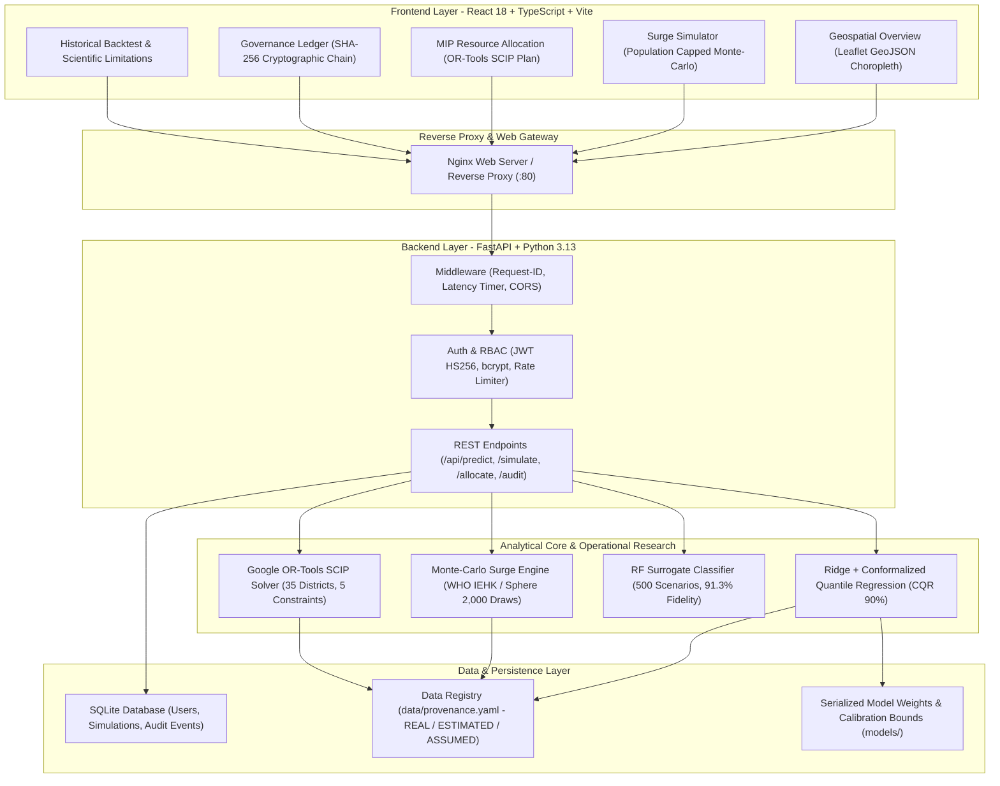

# Disaster Healthcare AI: Demand Prediction & Resource Allocation

> **An Explainable and Uncertainty-Aware Full-Stack AI Framework for Disaster Healthcare Demand Prediction and Multi-Objective Resource Allocation**  
> *Maharashtra 35 Districts* | React 18 & TypeScript | FastAPI & Python 3.13 | Google OR-Tools SCIP | Conformal Quantile Regression | SHA-256 Audit Ledger | Docker

---

## 1. System Architecture



---

## 2. Executive Overview

Disaster healthcare logistics during extreme natural hazards face severe spatial imbalances, sudden demand spikes, and opaque decision-making. This project delivers an **end-to-end, full-stack, and verifiable decision-support system** for disaster healthcare planning across Maharashtra's 35 administrative districts.

### Key Capabilities
- **Strict Data Provenance**: Every metric in the UI and API is explicitly badged as `REAL`, `ESTIMATED`, or `ASSUMED` according to `data/provenance.yaml`.
- **Honest Statistical Bounds**: Impact prediction utilizes Conformalized Quantile Regression (CQR 90%) on CRED EM-DAT India historical events (1920–2023). Discloses that while the model ranks events well (Spearman $\rho \approx 0.52$), extreme tail events can be underestimated by 30–150x.
- **Physical Population Invariants**: Simulated casualties are capped at resident district population ($\min(\text{affected}, \text{population})$), preventing unrealistic synthetic spikes.
- **Multi-Objective Network Optimization**: Solves inter-district medical transfers via Google OR-Tools SCIP Mixed-Integer Programming under 5 hard safety constraints (60% source reserve, high-risk export bans, 150 km blood transit limits, integer packs, non-negativity).
- **Cryptographic Audit Governance**: Human-in-the-loop review actions are sealed in a SHA-256 hash-chained ledger. An automated safety interlock blocks approval if scenario prediction confidence is below 0.60 (**HTTP 409 Conflict**).

---

## 3. Data Provenance & Real Foundations

| Asset / Dataset | Provenance Tag | Source / Methodology | Records & Notes |
|---|---|---|---|
| **EM-DAT Disaster Catalogue** | `REAL` | CRED EM-DAT International Disaster Database ([public.emdat.be](https://public.emdat.be/)) | 810 India disaster events (512 with targets); casualty figures never imputed. |
| **WorldPop Population Raster** | `REAL` | WorldPop 2020 1km Constrained Grid ([worldpop.org](https://www.worldpop.org/)) | Raw raster zonal sum: 131,936,179 vs 124.5M projection (5.97% gap documented as sanity check). |
| **National Hospital Directory** | `REAL` | Open Government Data Portal India ([data.gov.in](https://data.gov.in/)) | 4,767 Maharashtra health facilities classified by public/private mix. |
| **State ICU Beds Audit** | `REAL` | National Health Profile / Kapoor et al. (2020) | 11,587 total state ICU beds (2,572 public / 9,015 private). |
| **District Hospital Bed Capacity** | `ESTIMATED` | State Bed Anchor + Facility Count Weighting | Allocated from 144,983 state total hospital bed anchor across 35 districts. |
| **Epidemiological Consumption** | `ASSUMED` | WHO IEHK 2017 & Sphere Project Guidelines | Daily consumption rates per patient/injured day (`config/demand_params.yaml`). |
| **Road Transport Circuity** | `ASSUMED` | Haversine Distance $\times$ 1.3 Factor | Terrain circuity multiplier over 35 district centroids. |

> [!IMPORTANT]
> **Logistics Cost Policy**: Transport cost is strictly reported as a unitless **Cost Index** ($\text{unit\_km} \times 15.0 + \text{active\_routes} \times 500.0$) reflecting physical freight work and route overhead. It is **never** presented as currency (`₹`/`INR`).

---

## 4. Empirical Benchmarks

### A. Impact Prediction Model (Time-Split Test Set $N=78$, 2019+)

| Model | Test MAE (log) | Test $R^2$ (95% CI) | Test Spearman $\rho$ (95% CI) | Order-of-Magnitude Acc ($\le 0.5 \text{ dex}$) |
|---|---|---|---|---|
| **Median Baseline** | 3.5717 | -0.0952 | 0.0000 | 19.2% |
| **Ridge Regression** | **2.8812** | **0.2780** ([0.0787, 0.4331]) | **0.5199** ([0.3657, 0.6472]) | 20.5% |
| **XGBoost Regressor** | 3.0908 | 0.1403 | 0.4454 | 24.4% |
| **Random Forest** | 3.3204 | -0.0174 | 0.3078 | 23.1% |

- **CQR Coverage**: Empirical coverage on held-out test data is **94.9%** for nominal 90% target (conservative intervals).
- **Historical Backtesting**: Leave-One-Event-Out validation by `DisNo.` across benchmark disasters (`2005-0409-IND`, `2005-0541-IND`, `2001-0033-IND`, `1993-0074-IND`, `2019-0331-IND`).

### B. OR-Tools SCIP 20-Scenario Optimization Benchmark

Evaluated across 20 Monte-Carlo demand scenarios under full model uncertainty ($\sigma \approx 3.7186$) through a single shared constraint checker and unified cost function:

| Method | Mean Unmet Demand (units) | Mean Cost Index (Billions) | Mean Unit-KM | Mean Route-KM | Mean Min Coverage | Rule Violations |
|---|---|---|---|---|---|---|
| **OR-Tools SCIP** | **248,346,216.7** | **25.17** | 1,677,992,118.3 | **7,148.6 km** | **0.387** | **0** |
| **Greedy Largest Surplus** | 248,376,227.5 | 36.55 | 2,436,798,987.5 | 10,227.2 km | 0.321 | 0 |
| **Greedy Nearest** | 248,477,931.4 | 34.71 | 2,313,966,111.0 | 8,878.7 km | 0.321 | 0 |
| **Proportional Population** | 250,984,266.5 | 18.91 | 1,260,831,552.0 | 60,311.4 km | 0.283 | 0 |
| **No Redistribution** | 251,923,593.5 | 0.0 *(Excluded)* | 0.0 | 0.0 km | 0.270 | 0 |

---

## 5. Quickstart & Installation

### Option A: Local Development (Full-Stack)

#### 1. Backend Setup
```bash
# Activate virtual environment
# Windows: .venv\Scripts\Activate.ps1 | Linux/macOS: source .venv/bin/activate
pip install -r requirements.txt
pip install -r requirements-api.txt

# Run analytical pipeline (builds datasets and trains models)
python run_all.py

# Launch FastAPI backend (port 8000)
uvicorn api.main:app --reload --host 0.0.0.0 --port 8000
```
Swagger UI available at `http://localhost:8000/docs`.

#### 2. Frontend Setup
```bash
cd frontend
npm install
npm run dev
```
React web application available at `http://localhost:5173`.

---

### Option B: Docker Compose (Production Stack)

Deploy both containers (FastAPI + React via Nginx) with a single command:
```bash
# Build and run containers in detached mode
docker compose up --build -d

# Check running status
docker compose ps

# View backend logs
docker compose logs -f api

# Stop containers
docker compose down
```
- Web Application: `http://localhost` (or `http://localhost:5173`)
- REST API / Swagger: `http://localhost:8000/docs`

---

## 6. Testing & Quality Assurance

The codebase includes comprehensive test suites across both backend and frontend layers (100% passing):

```bash
# 1. Run Core Analytical Tests (25 tests: datasets, CQR intervals, SCIP constraints)
pytest tests/test_core.py -v

# 2. Run API, Auth & Cryptographic Audit Tests (23 tests)
pytest tests_api/ -v

# 3. Run Frontend Unit & Component Tests (Vitest)
cd frontend && npm test
```

---

## 7. Security & User Credentials (Development)

The system initializes with seed accounts for role-based governance:

| Username | Password | Role | Allowed Actions |
|---|---|---|---|
| `admin` | `admin123` | `admin` | Full control, audit chain recomputation, user management |
| `officer` | `officer123` | `officer` | Run simulations, trigger allocations, submit review decisions |
| `viewer` | `viewer123` | `viewer` | Read-only inspection of maps, backtests, and audit logs |

---

## 8. Documentation Index

- [REST API Reference](docs/API.md): Detailed endpoint definitions, payloads, response codes, and rate limits.
- [5-Minute Full-Stack Viva Demo Script](docs/DEMO_SCRIPT_FULLSTACK.md): Step-by-step viva presentation script with talking points.
- [Comprehensive Viva Q&A Guide](docs/VIVA_QA.md): 28 in-depth questions and answers for viva voce and technical review panels.
- [Project Progress & Audit Trail](PROGRESS.md): Verified implementation timeline and technical audit history.
